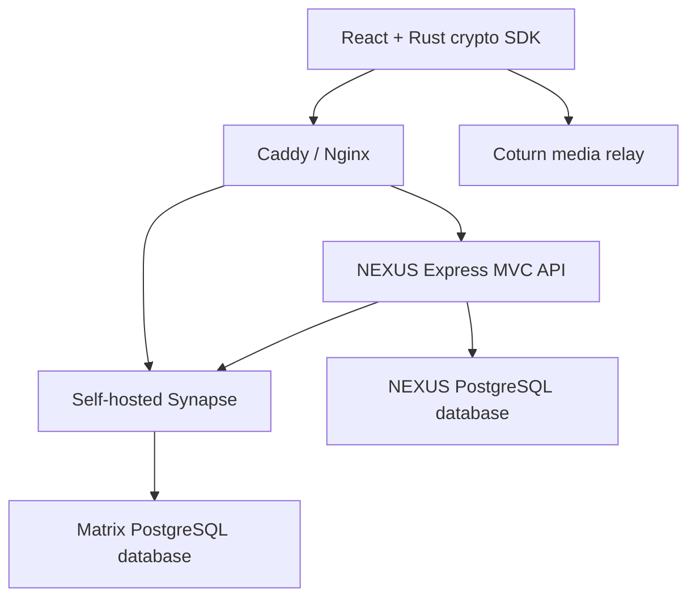
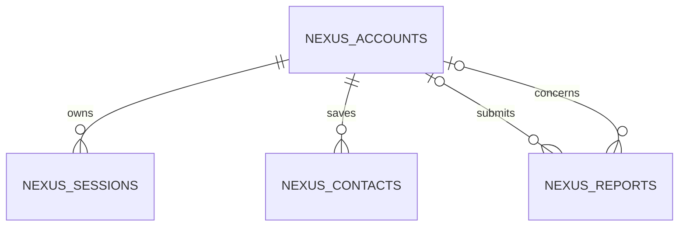

# Current architecture

This document supersedes the preliminary Signal/Socket.IO proposal for the source delivered in this repository. All implementation belongs to one root repository, not separate frontend and backend repositories.

## Responsibilities

| Component | Owns | Does not own |
|---|---|---|
| React frontend | UI state, client crypto integration, local verification, message decryption, media capture | Database credentials or service-admin tokens |
| Express MVC backend | Opaque browser sessions, profile mirror, contacts, reports, owner authorization/MFA | Private device keys or decrypted chat storage |
| Synapse | Account password authentication, device directory, Matrix rooms, ciphertext events, sync, TURN credentials | Clients' private message keys |
| PostgreSQL | Two isolated logical stores, one for NEXUS and one for Synapse | Plaintext private messages |
| Coturn | Authenticated media relay | Recorded call contents |
| Nginx | Frontend assets and same-origin API/Matrix routing | Exposed Synapse admin endpoints |
| Caddy production edge | Automatic TLS and reverse proxy to Nginx | App authorization |

Messages travel from the browser's Matrix SDK to Synapse as encrypted room events. They do not pass through a NEXUS `messages` controller. The SDK implements synchronization and device-session cryptography; duplicating that logic in Node would add an unnecessary second protocol. The frontend modules are the view layer of the overall application.

## Module request lifecycle

A protected API request passes same-origin checks, throttling, cookie-session validation, current Matrix token validation and CSRF checks for mutations. A route calls a controller; the controller calls a service; the service validates business rules and calls a model or provider. Models execute parameterized SQL. Responses omit raw database errors and credentials.

The administrator route adds role checks and recent TOTP verification. Codes cannot be reused after an accepted time step. An MFA grant lasts ten minutes. The service administrator token is encrypted only when held in a NEXUS user session; the separate internal Matrix service login token is kept in process memory. Both are authentication credentials, not message decryption keys.

## Local schema

- `nexus_accounts`: ID, unique username, display-name mirror, role, account status, preferences and last accepted MFA step.
- `nexus_sessions`: SHA-256 session-token hash, encrypted Matrix access token, device ID, CSRF-token hash, expiry and MFA deadline.
- `nexus_contacts`: owner/contact pair; mutations always bind the authenticated owner.
- `nexus_reports`: explicit user-submitted evidence, status and resolution. This is intentionally administrator-readable and separate from private chat storage.
- `nexus_audit`: administrator actions, actor, target, reason and outcome.
- `nexus_migrations`: applied SQL migration history.

The Matrix account and event schema is managed by Synapse. NEXUS does not write to Synapse tables directly.

## Consistency and recovery

There is no distributed transaction across Synapse and the NEXUS database. Account creation can succeed upstream before a later local operation fails; the user can try signing in, which repairs the local profile mirror. Suspending a user records STARTED, applies the upstream account lock, updates local status/revokes sessions, then records SUCCEEDED. Failures record FAILED; the operator must reconcile the upstream lock with local status before treating the action as complete.

Logout revokes the Matrix token before deleting the NEXUS session. Each subsequent authenticated API request checks the upstream token, so native device revocation/password reset cannot leave a usable stale NEXUS API session. A Matrix outage therefore fails protected requests closed.

## Tradeoffs from the original proposal

- JavaScript ES modules replace the proposed TypeScript scaffolding.
- Parameterized `pg` models and SQL migrations replace Prisma.
- Matrix sync replaces Socket.IO/Redis event routing.
- Synapse's native authentication replaces a custom Argon2id store.
- Matrix Olm/Megolm integration replaces a new Signal integration; it does not use MLS for groups.
- Room names, membership, event timing and some event metadata remain visible to the server.
- Ignore uses the Matrix ignored-user mechanism, not a universal server-level block rule.
- Group calls and encrypted recovery are not shipped.

These tradeoffs must be accepted before presenting this implementation as satisfying every original specification item.
